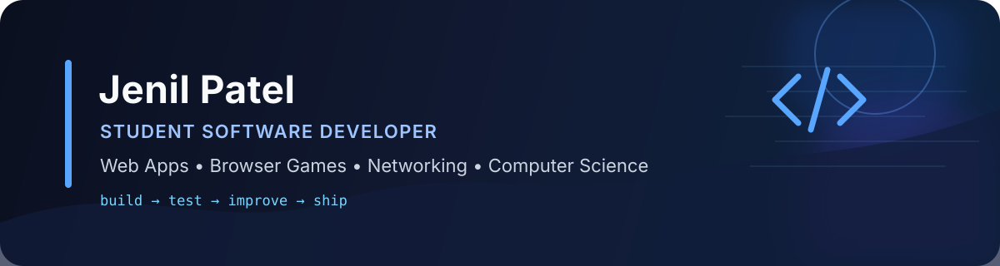

<p align="center">
  
</p>

<p align="center">
  <a href="https://github.com/dvilrgamerz?tab=repositories"></a>
  <a href="https://github.com/dvilrgamerz"></a>
</p>

## About Me

I'm **Jenil Patel**, a student developer who enjoys turning ideas into working software. I build browser apps, interactive tools, and games while learning more about **computer science, software engineering, networking, and game development**.

I care about projects that are more than demos: responsive interfaces, useful features, clear documentation, testing, accessibility, privacy-conscious design, and deployment.

- 🔭 Building practical web apps and browser games
- 🧠 Growing my skills in computer science, networking, and software development
- 🛠️ Comfortable learning by building, testing, debugging, and shipping
- 🎯 Interested in internships, entry-level opportunities, and collaborative projects

## Tech I Work With

<p>
  
  
  
  
  
  
  
  
</p>

**Also working with:** Canvas 2D, responsive/mobile-first UI, localStorage, browser APIs, game logic, GitHub Actions/CI, and deployment workflows.

## Featured Projects

<table>
<tr>
<td width="50%" valign="top">

### 📡 [WiFi Pulse V2](https://github.com/dvilrgamerz/wifi)

A mobile-first internet performance app with **two testing experiences**: a classic speed test and an original survival game that measures network quality during gameplay.

**Highlights**
- Ping, jitter, download, upload, and connection scoring
- Gaming / streaming / video-call readiness
- Installable PWA with local history
- Live network-health measurements during gameplay
- Responsive UI and browser-based deployment

**Tech:** JavaScript · HTML · CSS · PWA · Browser APIs

</td>
<td width="50%" valign="top">

### 🌌 [Nebula Survivors](https://github.com/dvilrgamerz/game-v2)

An original browser arena-survival game focused on polished gameplay systems, input support, accessibility settings, and reliable client-side behavior.

**Highlights**
- Endless waves, bosses, upgrades, and weapon evolutions
- Keyboard, mobile joystick, and gamepad support
- Graphics and accessibility settings
- Local high-score leaderboard
- Syntax checks, ESLint, gameplay validation, and UI smoke tests

**Tech:** JavaScript · Canvas 2D · HTML · CSS · CI

</td>
</tr>
<tr>
<td width="50%" valign="top">

### 💰 [VaultBudget](https://github.com/dvilrgamerz/VaultBudget1)

A local-first budgeting project designed to work in the browser without requiring a backend, with optional account backup through Supabase.

**Highlights**
- Local-first browser storage
- Optional Supabase account backup
- Privacy and terms pages
- GitHub Pages-ready deployment
- Keeps sensitive server credentials out of client code

**Tech:** JavaScript · HTML · CSS · Supabase

</td>
<td width="50%" valign="top">

### 🚀 More Projects

I regularly build and improve projects as I learn new technologies and workflows.

**Explore my repositories:**  
👉 [github.com/dvilrgamerz?tab=repositories](https://github.com/dvilrgamerz?tab=repositories)

I'm especially interested in projects involving **web development, games, networking, AI-assisted tools, and useful student-focused software**.

</td>
</tr>
</table>

## How I Build

```text
Idea → Prototype → Test → Debug → Polish → Deploy → Improve
```

I try to make each project stronger by focusing on:

- **Usability:** responsive layouts and clear user flows
- **Reliability:** validation, defensive code, and testing where practical
- **Performance:** lightweight browser experiences and sensible resource use
- **Privacy & security:** local-first storage when possible and careful handling of credentials
- **Documentation:** clear READMEs so projects are easy to understand and run

## GitHub Snapshot

<p align="center">
  
  
</p>

## Current Focus

Right now I'm continuing to improve my software-development fundamentals, build stronger portfolio projects, learn more about computer networking, and create projects that demonstrate what I can do—not just what I know.

---

<p align="center">
  <b>Thanks for visiting my profile.</b><br/>
  If you're reviewing my work for an opportunity, start with <a href="https://github.com/dvilrgamerz/wifi">WiFi Pulse V2</a> and <a href="https://github.com/dvilrgamerz/game-v2">Nebula Survivors</a>.
</p>
